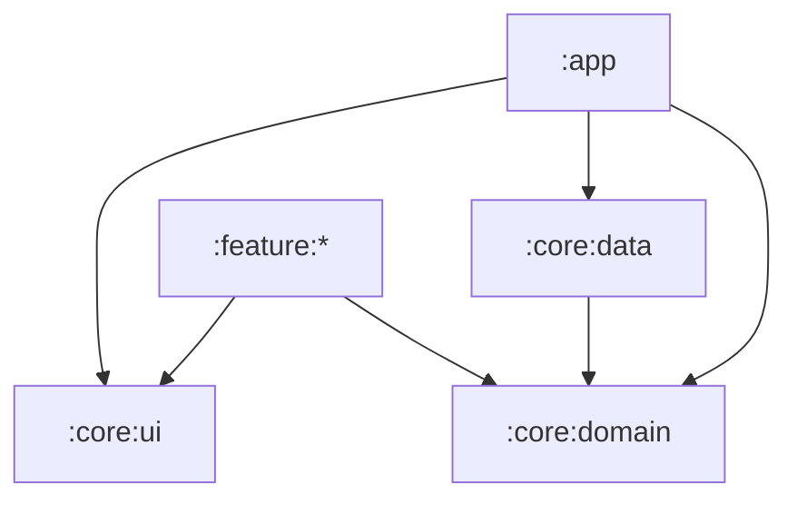

# Architecture

## Module structure

```text
open-gym/
├── build-logic/            # Included build - the `opengym.android.*` convention plugins
├── app/                    # Composition root - wires DI graph, declares Application/Activity
├── core/
│   ├── domain/             # Business logic - pure Kotlin JVM, zero Android deps
│   ├── data/               # Data access - Room, repositories, Hilt bindings
│   └── ui/                 # Shared Compose components and theming
└── feature/                # (placeholder) one sub-module per vertical slice
```

Gradle module names: `:app`, `:core:domain`, `:core:data`, `:core:ui`.

## Build logic

Shared Gradle configuration lives in `build-logic/`, an included build rather than
`buildSrc` so that editing a convention plugin does not invalidate every module's build
script cache. Its plugins read `gradle/libs.versions.toml` through the same catalog the
modules use.

| Plugin id | Applies |
| --- | --- |
| `opengym.android.library` | `com.android.library`, the SDK levels, the JVM toolchain, the shared `lint {}` block, and the JVM unit-test dependencies |
| `opengym.android.compose` | The Compose compiler plugin, `buildFeatures { compose = true }`, and the BOM-managed UI dependencies |
| `opengym.android.hilt` | Hilt and the KSP processor that generates its components |
| `opengym.android.feature` | The three above, plus `:core:domain` and `:core:ui` — everything a vertical slice needs |

A feature module's build file should be the plugin and a `namespace`, nothing more:

```kotlin
plugins {
    id("opengym.android.feature")
}

android {
    namespace = "com.opengym.feature.home"
}
```

`:app` and `:core:domain` are deliberately left out: `:app` is an application module with
signing config and build variants that is not worth generalising for one consumer, and
`:core:domain` is a plain Kotlin JVM library carrying a JaCoCo coverage floor no other
module shares. `compileSdk`, `minSdk` and the JVM toolchain are constants in
`build-logic/.../AndroidSdk.kt` rather than catalog entries — the catalog addresses
artifacts, and an SDK level is not one.

## Layers and responsibilities

### Domain (`:core:domain`)

The inner-most layer. Contains entities, use cases, and repository interfaces.
Must compile as a plain Kotlin JVM library - no `android {}` block, no Android imports.
All business rules live here so they can be tested without an Android runtime.

### Data (`:core:data`)

Implements the repository interfaces declared in `:core:domain`.
Owns all I/O: Room DAOs, remote API clients, data mappers.
Depends on `:core:domain` for the contracts it fulfils.
The schema, its migration strategy, and the storage assumptions analytics and import/export rely on are documented in [PERSISTENCE.md](PERSISTENCE.md).

### Presentation (`:core:ui` + future `:feature:*`)

Compose screens, ViewModels, and shared UI components.
ViewModels call domain use cases directly - they do not touch data sources.
`:core:ui` holds only reusable widgets and the design system; it carries no business logic.

### App (`:app`)

Composition root only. Declares `Application`, the single `Activity`, and the top-level navigation graph. Connects all layers through Hilt modules. Contains no business logic.

## Allowed dependency directions



## Prohibited dependencies

| From | May NOT depend on | Reason |
| ------ | ------------------- | -------- |
| `:core:domain` | `:core:data`, `:core:ui`, `:app`, `:feature:*` | Domain must be the stable, dependency-free centre |
| `:core:ui` | `:core:data` | Presentation must not bypass the domain layer |
| `:core:data` | `:core:ui`, `:app`, `:feature:*` | Data layer is unaware of how results are displayed |
| `:feature:*` | other `:feature:*` | Features are independent vertical slices; cross-feature navigation goes through `:app` |

Any dependency that violates these rules must be refactored: extract the shared concern into
`:core:domain` (if it is a contract) or `:core:ui` (if it is a visual primitive).

## Dependency injection (Hilt)

### Module location

Each Hilt module lives in a `di/` package inside the Gradle module that owns the dependency it provides - e.g. Room/DAO bindings live in `core/data/.../di/DatabaseModule.kt`. Do not centralize unrelated bindings in a single top-level module; split by concern instead.

### Scoping rules

| Scope | Component | Use for |
| --- | --- | --- |
| `@Singleton` | `SingletonComponent` | App-lifetime dependencies: database, DAOs, network clients, repositories |
| `@ViewModelScoped` | `ViewModelComponent` | Dependencies shared across a single ViewModel's injection graph but recreated per screen |
| *(none)* | any | Cheap, stateless objects (e.g. mappers) - a fresh instance per injection site is fine, don't over-scope |

### `@Provides` vs `@Binds`

Use `@Provides` when the type needs construction logic or you don't own its constructor (e.g. configuring a `Room.databaseBuilder`):

```kotlin
// ✅ construction logic required - @Provides is correct
@Provides
@Singleton
fun provideDatabase(@ApplicationContext context: Context): OpenGymDatabase =
    Room.databaseBuilder(context, OpenGymDatabase::class.java, "open-gym.db")
        .addMigrations(*OpenGymDatabase.MIGRATIONS)
        .build()
```

Use `@Binds` when you're only mapping an interface to an implementation - it's an abstract method, so Hilt generates the wiring without a method body:

```kotlin
// ✅ pure interface-to-impl mapping - @Binds is correct
@Binds
abstract fun bindWorkoutRepository(impl: WorkoutRepositoryImpl): WorkoutRepository

// ❌ no construction logic here - should be @Binds, not @Provides
@Provides
fun provideWorkoutRepository(impl: WorkoutRepositoryImpl): WorkoutRepository = impl
```
