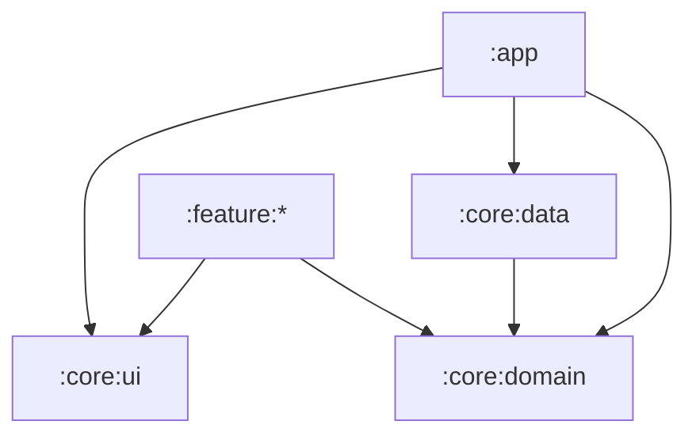

# Architecture

## Module structure

```text
open-gym/
├── app/                    # Composition root - wires DI graph, declares Application/Activity
├── core/
│   ├── domain/             # Business logic - pure Kotlin JVM, zero Android deps
│   ├── data/               # Data access - Room, repositories, Hilt bindings
│   └── ui/                 # Shared Compose components and theming
└── feature/                # (placeholder) one sub-module per vertical slice
```

Gradle module names: `:app`, `:core:domain`, `:core:data`, `:core:ui`.

## Layers and responsibilities

### Domain (`:core:domain`)

The inner-most layer. Contains entities, use cases, and repository interfaces.
Must compile as a plain Kotlin JVM library - no `android {}` block, no Android imports.
All business rules live here so they can be tested without an Android runtime.

### Data (`:core:data`)

Implements the repository interfaces declared in `:core:domain`.
Owns all I/O: Room DAOs, remote API clients, data mappers.
Depends on `:core:domain` for the contracts it fulfils.

### Presentation (`:core:ui` + future `:feature:*`)

Compose screens, ViewModels, and shared UI components.
ViewModels call domain use cases directly - they do not touch data sources.
`:core:ui` holds only reusable widgets and the design system; it carries no business logic.

### App (`:app`)

Composition root only. Declares `Application`, the single `Activity`, and the top-level
navigation graph. Connects all layers through Hilt modules. Contains no business logic.

## Allowed dependency directions



## Prohibited dependencies

| From | May NOT depend on | Reason |
|------|-------------------|--------|
| `:core:domain` | `:core:data`, `:core:ui`, `:app`, `:feature:*` | Domain must be the stable, dependency-free centre |
| `:core:ui` | `:core:data` | Presentation must not bypass the domain layer |
| `:core:data` | `:core:ui`, `:app`, `:feature:*` | Data layer is unaware of how results are displayed |
| `:feature:*` | other `:feature:*` | Features are independent vertical slices; cross-feature navigation goes through `:app` |

Any dependency that violates these rules must be refactored: extract the shared concern into
`:core:domain` (if it is a contract) or `:core:ui` (if it is a visual primitive).
