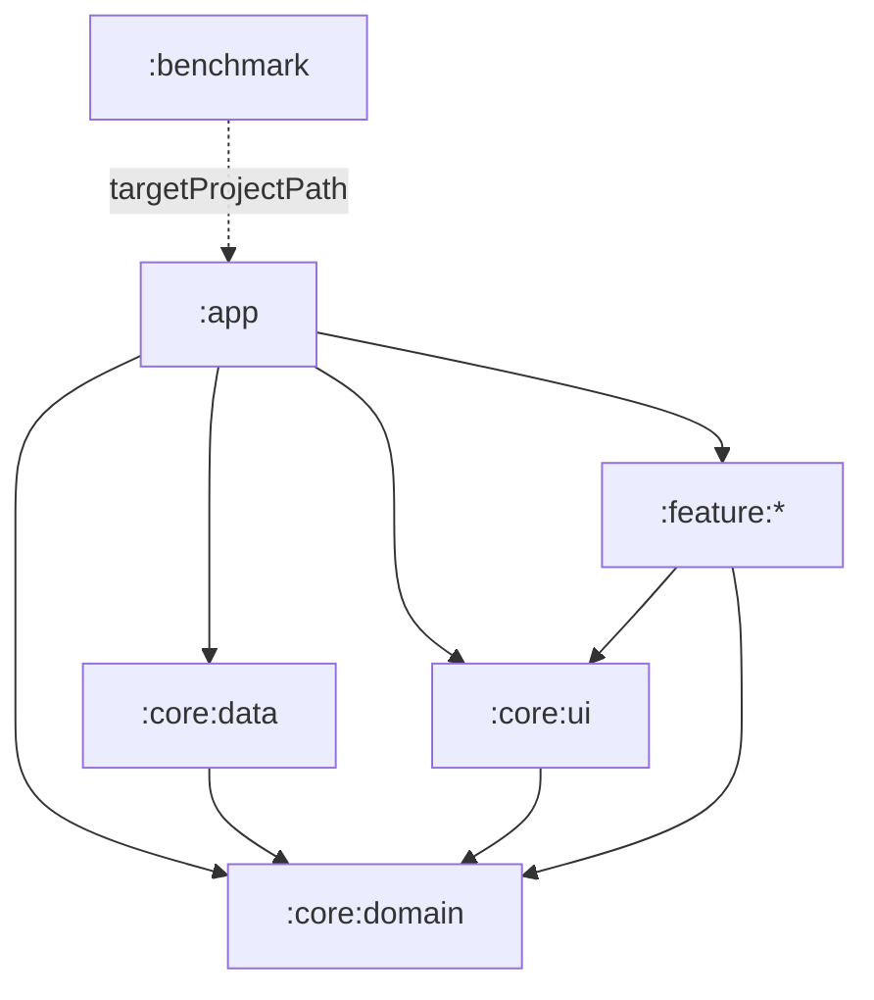

# Architecture

## Module structure

```text
titan/
├── build-logic/            # Included build - the `titan.android.*` convention plugins
├── app/                    # Composition root - wires DI graph, declares Application/Activity
├── benchmark/              # On-device Macrobenchmarks and the Baseline Profile generator
├── core/
│   ├── domain/             # Business logic - pure Kotlin JVM, zero Android deps
│   ├── data/               # Data access - Room, repositories, Hilt bindings
│   ├── ui/                 # Shared Compose components, design system, theming
│   └── testing/            # Test support shared by every Compose module's unit tests (#40)
└── feature/                # One sub-module per vertical slice
    ├── onboarding/         # The first-run flow (not a tab; where a fresh install opens)
    ├── home/               # The dashboard (Home tab)
    ├── session/            # New session -> active session -> summary (not a tab)
    ├── history/            # Session browsing: history, templates, calendar (Sessions tab)
    ├── progression/        # Analytics and gamification (Stats tab)
    └── settings/           # Settings, backup and the import from another app (reached from the top app bar, not a tab)
```

Gradle module names: `:app`, `:benchmark`, `:core:domain`, `:core:data`, `:core:ui`,
`:core:testing`, `:feature:onboarding`, `:feature:home`, `:feature:session`,
`:feature:history`, `:feature:progression`, `:feature:settings`.

`:core:testing` ships nothing and is on no main classpath. It holds the Roborazzi preview
tester that runs the Accessibility Test Framework over every `@Preview`, and the
`assertAccessible()` a screen test calls — see [ACCESSIBILITY.md](ACCESSIBILITY.md). The
`titan.android.compose` plugin adds it as `testImplementation` to `:core:ui` and every
feature; it depends on no module of this project, and `checkArchitecture` holds it to that.

`:benchmark` is the only one that is neither a layer nor a slice. It is a
`com.android.test` module: it ships nothing, it produces an APK that instruments `:app`'s
`benchmark` build type from a second process, and it holds the on-device measurements and
the Baseline Profile generator (#42). See [benchmark/README.md](../benchmark/README.md) for
what it measures and how to run it.

## Build logic

Shared Gradle configuration lives in `build-logic/`, an included build rather than
`buildSrc` so that editing a convention plugin does not invalidate every module's build
script cache. Its plugins read `gradle/libs.versions.toml` through the same catalog the
modules use.

| Plugin id | Applies |
| --- | --- |
| `titan.jvm.toolchain` | The JDK Kotlin and javac compile with: `jdk` from `jdkVendor` in the version catalog, which build-logic's own build script reads too |
| `titan.android.library` | `com.android.library`, the SDK levels, the JVM toolchain, the shared `lint {}` block, and the JVM unit-test dependencies |
| `titan.android.compose` | The Compose compiler plugin, `buildFeatures { compose = true }`, and the BOM-managed UI dependencies |
| `titan.android.hilt` | Hilt and the KSP processor that generates its components |
| `titan.android.feature` | The three above, plus `:core:domain`, `:core:ui` and the ViewModel-to-Compose bridge — everything a vertical slice needs |
| `titan.android.benchmark` | `:benchmark` only. `com.android.test`, the Macrobenchmark runner, the API 29 floor those metrics need, and the `benchmark` build type — see below |
| `titan.architecture` | Root project only. Registers `checkArchitecture`, which asserts the module dependency graph against this document |

`titan.android.compose` and `titan.android.hilt` apply `titan.android.library`
themselves, so the order a module lists them in does not matter.

A feature module's build file should be the plugin and a `namespace`, nothing more:

```kotlin
plugins {
    id("titan.android.feature")
}

android {
    namespace = "com.titan.feature.home"
}
```

`:app` and `:core:domain` are deliberately left out: `:app` is an application module with
signing config and build variants that is not worth generalising for one consumer, and
`:core:domain` is a plain Kotlin JVM library carrying a JaCoCo coverage floor no other
module shares. Both apply `titan.jvm.toolchain`, so the JDK is chosen in one place, but `:app`
keeps its own copy of the SDK levels, and a bump has to be made in both places — `:app` in
particular is the module that ships.

`titan.android.benchmark` *is* a convention plugin for a single module, which the others
avoid being. It exists anyway because what it configures is not a preference: a
`com.android.test` module that runs against a debuggable build, or below API 29, or in the
app's own process, produces numbers that look fine and mean nothing. Those three decisions
belong somewhere a reader will find them rather than in a build file nobody opens twice.

For everything else, `compileSdk`, `minSdk` and the JVM toolchain are constants in
`build-logic/.../AndroidSdk.kt` rather than catalog entries — the catalog addresses
artifacts, and an SDK level is not one.

## Layers and responsibilities

### Domain (`:core:domain`)

The inner-most layer. Contains entities, use cases, and repository interfaces.
Must compile as a plain Kotlin JVM library - no `android {}` block, no Android imports.
All business rules live here so they can be tested without an Android runtime.

### Data (`:core:data`)

Implements the repository interfaces declared in `:core:domain`.
Owns all I/O: Room DAOs, remote API clients, data mappers.
Depends on `:core:domain` for the contracts it fulfils.
The schema, its migration strategy, and the storage assumptions analytics and import/export rely on are documented in [PERSISTENCE.md](PERSISTENCE.md).

### Presentation (`:core:ui` + future `:feature:*`)

Compose screens, ViewModels, and shared UI components.
ViewModels call domain use cases directly - they do not touch data sources.
`:core:ui` holds only reusable widgets and the design system; it carries no business logic.

`core/ui/.../component/` holds the widgets more than one feature needs — the set row, the
exercise card, the rest timer, the stat tile, the body diagram. Every one of them is
stateless and hoisted, takes `:core:domain` types where a domain type is the natural input,
and calls no repository or use case; see CONTRIBUTING.md § Using the design system for the
table and the rule against reimplementing one in a feature.

`core/ui/.../state/` holds the presentation-layer plumbing a ViewModel needs and a widget does
not: `savedScreenState`, which is how every screen's own state survives a process death, and the
`LocalDate` serializer it needs to do it. Still no business logic — it is a `SavedStateHandle`
and an encoding, and what each screen decides to keep in it is the screen's. See
docs/PERSISTENCE.md, "Saved instance state, and where it stops".

The design system lives in `core/ui/.../theme/` and is four things: a Material 3
`ColorScheme` per mode, a `Typography` on the wireframes' scale, `TitanSpacing` and
`TitanShapes`. Material's own tokens are reached through `MaterialTheme`; the two roles it
has no slot for — the mono `numeric` styles and the `eyebrow` section header — are reached
through the `TitanTheme` object, so a call site always says which vocabulary a value comes
from. **A screen should need no raw `dp` literal for standard rhythm and no `Color(...)` at
all.**

`TitanTheme` also carries the two *stored* preferences that change how every screen renders
— the colour scheme and the unit system, as the domain's own `ThemePreference` and
`UnitSystem`. `:app` collects `UserPreferencesRepository` once at the root (`MainViewModel`)
and passes both in, so a preference write recomposes the whole app: no screen subscribes to
the theme, and none has to. The unit system is published as `LocalUnitSystem` for the
formatters in `core/ui/.../format/` to read.

Two decisions are recorded in the source and worth knowing before writing a screen:
dynamic colour (Material You) is **not** supported, because the single accent is the app's
only signal and wallpaper-derived colour would make it a different colour on every device;
and both schemes are held to WCAG AA by `ColorSchemeContrastTest`, which fails the build
rather than recording a figure that was true once.

### App (`:app`)

Composition root only. Declares `Application`, the single `Activity`, and the top-level navigation graph. Connects all layers through Hilt modules. Contains no business logic.

## Allowed dependency directions



| Edge | Why it is allowed |
| --- | --- |
| `:app` → everything | Composition root; it is the only place the layers are wired together |
| `:core:data` → `:core:domain` | Implements the repository interfaces the domain declares |
| `:core:ui` → `:core:domain` | Shared components take domain types directly — `RestTimerBar(state: RestTimerState)`, `StatChip(stat: SessionStats)` — rather than each feature translating into a private mirror of the same model. `:core:domain` is pure Kotlin with zero Android dependencies, so the edge carries nothing upward |
| `:feature:*` → `:core:domain` | ViewModels call use cases directly |
| `:feature:*` → `:core:ui` | The design system and shared widgets |
| `:benchmark` → `:app` | Not a dependency anybody wrote. `targetProjectPath = ":app"` is what AGP turns into this edge, and it means "install these two APKs together" — the benchmark drives a release-like build through UiAutomator and never links against it |

`:core:ui` → `:core:domain` is a dependency on *types*, not on behaviour. A shared
component may accept and render a domain model; it may not call a use case or a
repository. That work belongs to the feature's ViewModel.

## Prohibited dependencies

| From | May NOT depend on | Reason |
| ------ | ------------------- | -------- |
| `:core:domain` | `:core:data`, `:core:ui`, `:app`, `:feature:*` | Domain must be the stable, dependency-free centre |
| `:core:ui` | `:core:data` | Presentation must not bypass the domain layer |
| `:core:data` | `:core:ui`, `:app`, `:feature:*` | Data layer is unaware of how results are displayed |
| `:feature:*` | other `:feature:*` | Features are independent vertical slices; cross-feature navigation goes through `:app` |
| `:benchmark` | everything except `:app` | A benchmark that compiles against the code it measures reaches for a `@Composable` within a week, and is then a slow instrumentation test rather than a measurement of the shipping build. Its handles on the app are the resource ids in `TitanTestTags`, restated as strings |

Any dependency that violates these rules must be refactored: extract the shared concern into
`:core:domain` (if it is a contract) or `:core:ui` (if it is a visual primitive).

### The rules are enforced, not just documented

`./gradlew checkArchitecture` reads every module's declared project dependencies and
asserts them against the two tables above. It is wired into every module's `check`, so
`./gradlew build` runs it, and CI runs it by name in the `check` job.

Gradle itself objects only to a *cycle*, so before this task existed the tables held exactly
as long as everybody remembered them — the first violation would have been caught in review,
or not at all.

The rules live in `build-logic/.../ArchitectureRules.kt` and are covered by
`ArchitectureRulesTest`, which is what proves the check can fail: a green run on a legal
graph is indistinguishable from a check that never fires. `./gradlew checkBuildLogic` runs
those tests — an included build's `test` task is not otherwise reached by anything the main
build invokes.

**A module with no rule fails the check.** A new `:core:network` or `:feature:map` has to
be added to the table above and to `ArchitectureRules` before it may depend on anything.
The alternative — an unlisted module defaulting to "anything goes" — would make the check
quietly weaker every time the project grew.

## Navigation

### Features do not know about each other

`:feature:*` modules may not depend on one another, so a feature cannot name another
feature's destination. Instead each feature exposes a `NavGraphBuilder` extension and
hoists every outbound navigation action as a lambda. `:app` owns the `NavHost`, calls
each extension, and supplies the lambdas — it is the only place in the codebase that
calls `navController.navigate(...)` across a module boundary.

```kotlin
// :feature:home — declares what it needs to leave with, not where it goes
fun NavGraphBuilder.homeGraph(
    onStartEmptySession: () -> Unit,
    onResumeSession: (sessionId: Long) -> Unit,
) {
    composable<HomeDestination> {
        HomeRoute(
            onStartEmptySession = onStartEmptySession,
            onResumeSession = onResumeSession,
        )
    }
}
```

```kotlin
// :app — the only module that knows both sides of the edge
NavHost(navController = navController, startDestination = HomeDestination) {
    homeGraph(
        onStartEmptySession = { navController.navigate(NewSessionDestination(pickExercises = true)) },
        onResumeSession = { id -> navController.navigate(ActiveSessionDestination(id)) },
    )
    sessionGraph(
        onSessionFinished = { id -> navController.navigate(SummaryDestination(id)) },
    )
}
```

**Destination types live in the module that owns the screen.** `ActiveSessionDestination`
is declared in `:feature:session` and `:app` imports it. This is the one direction that
works: `:app` already depends on every feature, so no new edge is created, and the
feature that owns a screen owns the shape of its arguments.

A lambda parameter named for the *event* (`onSessionFinished`) rather than the
destination (`goToSummary`) keeps the feature honest — it is reporting what happened, and
`:app` decides where that leads.

### Routes are type-safe

Destinations are `@Serializable` objects or data classes, navigated with
`composable<XDestination>` and read back with `toRoute<XDestination>()`. No string route
templates, no `navArgument` declarations, no manual argument parsing — a wrong argument
type is a compile error rather than a null at runtime.

```kotlin
@Serializable
data object HomeDestination

@Serializable
data class ActiveSessionDestination(val sessionId: Long)

composable<ActiveSessionDestination> { entry ->
    val destination: ActiveSessionDestination = entry.toRoute()
    ActiveSessionRoute(sessionId = destination.sessionId)
}
```

**`XDestination` and `XRoute` are different things and must not share a name.**
`XDestination` is the `@Serializable` navigation argument type; `XRoute` is the stateful
composable that renders the screen (CONTRIBUTING.md § Screens). Naming both `XRoute` is a
trap: for a `data object` the screen call fails to compile, and for a `data class` it
compiles clean and renders an empty screen, because `ActiveSessionRoute(sessionId = ...)`
resolves to the route constructor and the result is discarded.

The `titan.android.feature` convention plugin applies the `kotlin-serialization`
plugin, so a feature module needs no extra setup to declare one.

### The shell: a tab scaffold, and modes outside it

`:app` composes one `Scaffold` whose chrome is driven entirely by where the user is.

```text
TabsGraphDestination            bottom bar + top bar
├── HomeGraphDestination        -> HomeDestination
├── HistoryGraphDestination     -> SessionsDestination, TemplateEditorDestination
├── LibraryGraphDestination     -> ExerciseLibraryDestination
└── ProgressionGraphDestination -> StatsDestination

SessionGraphDestination         full screen, no bars
└── NewSession -> ActiveSession -> SessionSummary

OnboardingDestination           full screen, no bars
ExercisePickerDestination       full screen, no bars
ExerciseDetailDestination       full screen, no bars
SettingsDestination             full screen, no bars
```

Settings is the one non-tab destination that is a *flat* destination rather than a nested
graph: the graph-per-tab exists so the bottom bar can ask whether a tab's route is anywhere in
the current destination's hierarchy, and settings has no tab to keep selected.

**The import from another app crosses two features through `:app`.** `ImportDestination` lives
in `:feature:settings`, beside the backup it is the opposite of, and is pushed from the Data &
privacy row. Onboarding's last step offers it too, and onboarding may not name another feature's
destination, so it reports `onFinishedIntoImport` and `:app` turns that into Home with the import
pushed over it. The import's notifications reach it through `titan://settings/import`. The import
itself does not run on the screen at all: the screen hands it to `HistoryImportRunner`, a domain
port that `:core:data` implements as a foreground WorkManager worker, and observes it — see
PERSISTENCE.md, "Importing from another app".

**The template editor is the first screen to live *inside* a tab.** Everything else pushed over
the shell — the exercise detail, the plate calculator, the picker — is a mode with its own bar;
a template is read and edited from the list of templates, and the list is a tab. That is the
whole reason a tab is a graph rather than a bare destination, and #92 is where the second
destination finally arrived.

**Each tab is a nested graph, not a bare destination.** The bottom bar decides which tab is
selected by asking whether a tab's route appears anywhere in the current destination's
`hierarchy`. With a graph per tab that question has one answer for every screen the tab will
ever hold; with a flat destination it works only while the tab is one screen deep, and then
breaks silently — the tab simply stops looking selected.

Per-tab back stacks come from the standard trio in
`TitanAppState.navigateToTopLevelDestination`: `popUpTo(startDestination) { saveState }`,
`restoreState`, `launchSingleTop`. Returning to a tab resumes where the user left it —
except when the tab is the one you are already in, where both state flags invert and the pop
stands, so pressing the active tab returns it to its root.

**The session flow is a mode, not a place.** It sits outside the tab scaffold and hides both
bars, because offering a tap into Stats mid-set is an invitation to lose the set being
logged. Onboarding sits outside the scaffold the same way.

**Where the app opens is decided once per launch.** `MainViewModel` reads
`UserPreferences.onboardingCompleted` and *latches* the answer as
`MainUiState.Ready.startsOnOnboarding`, which `:app` passes down to the `NavHost` as its start
destination. It is latched rather than followed live because Navigation Compose rebuilds the
graph — and empties the back stack — when `startDestination` changes, and the flag flips at the
*end* of onboarding: read live, it would tear the graph down underneath the very navigation
onboarding is making. Finishing is a `navigate(TabsGraphDestination)` with
`popUpTo<OnboardingDestination> { inclusive = true }`, so the back gesture from Home leaves the
app rather than re-asking questions the user has just answered.

**The five onboarding steps are state, not five destinations.** The flow is one flat
destination whose current step lives in its ViewModel. Putting the steps on the back stack
would make "leave nothing of onboarding behind" a property that has to be re-established every
time a step is added, where one destination makes it a single `popUpTo`. The system back
gesture is handled *inside* the screen, walking back one question at a time and falling through
to the platform on the first step — where leaving costs nothing, because the completion flag is
written last and the next launch opens the flow again.

Four tabs, not the wireframes' five: Map has no content until the Gym Map milestone, and Settings is a gear in
the top app bar rather than a fifth of the bar given to a destination visited twice.

**The exercise catalogue is a tab and a modal, and one screen.** `ExerciseLibraryDestination`
is the Library tab; `ExercisePickerDestination` is the same screen with `selecting` flipped,
pushed over a workout with the bars gone so a picker cannot offer a jump to Stats. Two
destinations rather than one with a boolean argument, because a route registered in two graphs
is ambiguous to the `NavController`, which resolves by route pattern. The screen tells them
apart by whether it was given an `onBack`: the tab has none, since a back arrow above a tab is
a control that either does nothing or drops the user out of the tab they just chose.

**One exercise's detail screen is a mode too, and one destination.** Both the tab and the
picker open `ExerciseDetailDestination`, and it sits outside the tab scaffold: it is a
full-width reading surface with its own bar, and the shell's "Library" title with a settings
gear is not what somebody looking at a bench press needs. Because it is registered *once*,
the difference between its two callers is a route argument (`addToSession`) rather than a
second destination — the opposite trade from the pair above, and for the same reason: one
route pattern, one registration.

Its "Add to session" hands the exercise back to the picker as a value written onto the
previous back stack entry's `SavedStateHandle` before the pop, since Navigation Compose has
no "start for result" and a feature cannot reach the `NavController`. The key lives next to
the destination that reads it, in `HistoryNavigation.kt`.

**The picker's own result does not travel that way, and cannot.** One of its readers is in
*another* feature module — the new-session flow, and the workout after it — so a key would have
to be named on both sides of an edge the module rules forbid, and a constant duplicated with
a comment asking nobody to change one copy is not a contract. `:app` holds the selection in
`rememberSaveable` state instead and hands it to whoever opened the picker as an ordinary
parameter (`ExercisePicker` in `SessionNavigation.kt`, `TemplateEditor` in
`HistoryNavigation.kt`). It is the one module that knows both sides of that edge, which is the
whole reason it exists.

The template editor is in the *same* module as the picker and could have used a key, and does
not: the two callers would then return their answers by two different mechanisms, and one
`rememberSaveable` in `:app` serves both. Only one of them is ever on the back stack — the
editor is inside the tabs, the session flow is a mode over them — so there is nothing to
disambiguate.

**A screen's cross-module result is `:app`'s to carry; a screen's result to its own module
may ride the back stack.** That is the rule the two halves above are instances of.

### Motion follows the same split

The `NavHost` sets all four transitions once, and each asks `NavMotion.motionBetween` what
the move it is animating *means* rather than which routes it connects:

| Move | Motion | Why |
| --- | --- | --- |
| Tab to tab | fast fade | A lateral jump between peers. There is no direction to show. |
| Within a tab, or one step of the session flow to the next, or out to Settings | horizontal slide with parallax | A push. The slower counter-slide is what reads as one screen over another. |
| Into or out of the session flow | vertical slide | The one move that is a mode change, so the one that should not look like a push. |
| A destination replacing itself — re-tapping the active tab | vertical slide, no fade or parallax | Nowhere new is being gone: the screen is being put back to its top, so it is drawn as the flick to the top it stands in for. |

The reset is the one classification that is not a function of `ShellChrome` alone — both ends
are the same tab, so it takes `initialState.destination.id == targetState.destination.id` as a
third input. It exists because re-tapping the active tab at its root *does* rebuild the screen:
`popUpTo` drops the entry and the navigate pushes a fresh one, which is what leaves a long list
at the top rather than where the user had scrolled to. Drawn as a push from the side, that read
as arriving somewhere new; drawn as a slide down from above, it reads as the scroll it is.

The classification is derived from `ShellChrome` — the same value that decides which tab is
selected and whether the bars are shown — so a destination added to a tab's graph animates
correctly without opting in, and there is no second list of routes to keep in step.

**Portrait only.** `MainActivity` declares `screenOrientation="portrait"`. Landscape is a
surface every screen would have to lay out and screenshot-test twice, for a phone held
one-handed over a bench. Note that at `targetSdk` 36 Android 16 ignores the restriction on
displays 600dp and wider, so this is a phone-only lock by construction; revisit with tablet
layouts.

## Dependency injection (Hilt)

### Module location

Each Hilt module lives in a `di/` package inside the Gradle module that owns the dependency it provides - e.g. Room/DAO bindings live in `core/data/.../di/DatabaseModule.kt`. Do not centralize unrelated bindings in a single top-level module; split by concern instead.

### Scoping rules

| Scope | Component | Use for |
| --- | --- | --- |
| `@Singleton` | `SingletonComponent` | App-lifetime dependencies: database, DAOs, DataStore, repositories |
| `@ViewModelScoped` | `ViewModelComponent` | Dependencies shared across a single ViewModel's injection graph but recreated per screen |
| *(none)* | any | Cheap, stateless objects (e.g. mappers) - a fresh instance per injection site is fine, don't over-scope |

### `@Provides` vs `@Binds`

Use `@Provides` when the type needs construction logic or you don't own its constructor (e.g. configuring a `Room.databaseBuilder`):

```kotlin
// ✅ construction logic required - @Provides is correct
@Provides
@Singleton
fun provideDatabase(@ApplicationContext context: Context): TitanDatabase =
    Room.databaseBuilder(context, TitanDatabase::class.java, "titan.db")
        .addMigrations(*TitanDatabase.MIGRATIONS)
        .build()
```

Use `@Binds` when you're only mapping an interface to an implementation - it's an abstract method, so Hilt generates the wiring without a method body:

```kotlin
// ✅ pure interface-to-impl mapping - @Binds is correct
@Binds
abstract fun bindWorkoutRepository(impl: WorkoutRepositoryImpl): WorkoutRepository

// ❌ no construction logic here - should be @Binds, not @Provides
@Provides
fun provideWorkoutRepository(impl: WorkoutRepositoryImpl): WorkoutRepository = impl
```
