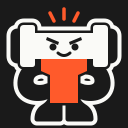
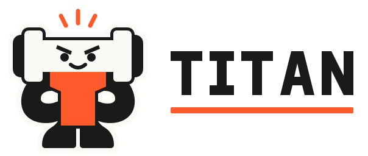

# Titan brand kit

The Titan mascot is a dumbbell with a face, standing hands-on-hips in an orange shirt. It is
flat: three colours, no gradients, no shading. Every file here is generated from the
scripts next to it, so the geometry and the colours live in exactly one place.

<p>
  
  
  
</p>

## Files

| File | Use it for |
|---|---|
| `svg/titan-mascot.svg` | The mascot, with its cream outline. Default choice; reads on any background |
| `svg/titan-mascot-no-outline.svg` | On light backgrounds, where the cream outline adds nothing |
| `svg/titan-mascot-on-dark.svg` | The mascot on its own dark field (social avatars, slides) |
| `svg/titan-mascot-mono-black.svg` | One-colour jobs: print, stamps, embroidery, laser |
| `svg/titan-head.svg` | Head only, for small spaces where the body would turn to mush |
| `svg/titan-lockup-dark.svg` / `-light.svg` | Mascot + wordmark, for headers and the README |
| `svg/titan-icon*.svg` | The launcher icon on its 108-unit adaptive grid (full, dark, layers): the mascot's head with the cartoon taken out, a dumbbell and two brow slashes |
| `svg/titan-favicon.svg`, `favicon.ico` | Web favicon (16/32/48 in the `.ico`) |
| `svg/titan-play-icon.svg`, `png/titan-play-icon-512.png` | Play Store listing icon |
| `png/` | PNG exports of all of the above at common sizes, transparent where the SVG is |

The Android launcher icon itself is `app/src/main/res/mipmap-anydpi/ic_launcher.xml`, whose
layers `icon.py` writes into `app/src/main/res/drawable/`.

## Colour

| Name | HEX | RGB | Role |
|---|---|---|---|
| Titan orange | `#FF5A2B` | 255 90 43 | The shirt, the icon field, the energy marks, the wordmark underline |
| Ink | `#1A1A1A` | 26 26 26 | Limbs, plates, face, keylines; dark backgrounds |
| Cream | `#FAFAF7` | 250 250 247 | The dumbbell head, the outline; light backgrounds |

Ink and cream are the light theme's `ink` and `paper` (`core/ui/.../theme/Color.kt`). The
orange is the mascot's own, between the UI accent's two values (`#CC4226` light, `#FF6B3D`
dark); keep it in the mascot and the icon, not in the UI, where the accent is tuned for
contrast. For print, get a proof — screen orange does not survive CMYK
unchanged.

## Clear space and minimum size

- **Clear space:** leave at least the height of the dumbbell bar (about a fifth of the
  mascot's height) free on every side. The energy marks above the head count as part of
  the mascot.
- **Minimum size:** full mascot 48 px / 12 mm tall; lockup 32 px tall; below that, use
  `titan-head.svg`, and below 24 px the favicon.

## Do

- Use the outlined mascot on photos and busy or mid-tone backgrounds.
- Use the one-colour version whenever only one ink is available — not a tinted full-colour one.
- Scale it as a whole.

## Don't

- Recolour the shirt or the head, or add gradients, shadows or glows.
- Stretch, skew or rotate it, or redraw the face with another expression.
- Put the no-outline version on a dark background — the limbs disappear.
- Set "TITAN" in a font next to the mascot; use the lockup, whose letters are drawn.
- Crowd it inside its clear space, or place it on orange without the outline.

## Changing it

```bash
python3 mascot.py   # svg/titan-mascot*, titan-head, lockups
python3 icon.py     # svg/titan-icon*, favicon, Play icon, and the app's launcher layers
python3 export.py   # png/ and favicon.ico (needs Chromium or Chrome, and ImageMagick)
```

Edit the scripts, never the generated files: the next run overwrites them.
